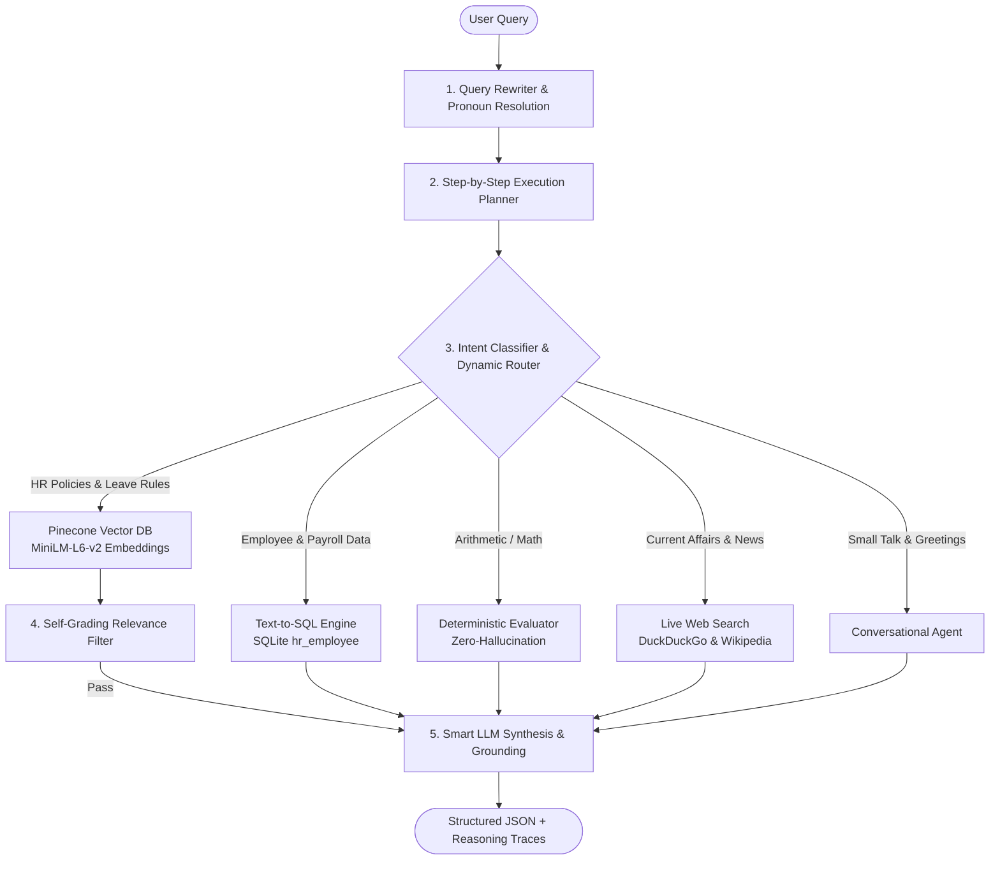

# 🌐 HR-Verse: Enterprise Agentic RAG & Multi-Tool AI Orchestrator

[](https://www.python.org/)
[](https://www.djangoproject.com/)
[](https://langchain-ai.github.io/langgraph/)
[](https://www.pinecone.io/)
[](https://groq.com/)
[](https://opensource.org/licenses/MIT)

An enterprise-grade **Agentic Retrieval-Augmented Generation (RAG)** platform designed to dynamically route user questions across unstructured policy handbooks, relational databases, live web search, and deterministic arithmetic engines with self-correcting grounding and zero hallucinations.

---

## 🏛️ System Architecture



---

## ✨ Key Capabilities

1. **Stateful Multi-Agent Orchestration (LangGraph):**
   - Implements a cyclic `StateGraph` that plans, routes, retrieves, grades, and synthesizes answers.
   - Decomposes multi-part comparative queries (e.g., *"Compare compensation and benefits"*) into parallel sub-retrievals.

2. **Hybrid Multi-Modal Tool Access:**
   - **Unstructured Document Retrieval:** Vector similarity search (`hr-policy-index-v2`, `k=3`) against official HR policy handbooks.
   - **Text-to-SQL Execution:** Automatically translates natural language queries into valid SQLite queries against `hr_employee`.
   - **Deterministic Arithmetic Engine:** Sandboxed mathematical evaluator guaranteeing 100% accuracy on complex calculations without LLM hallucination.
   - **Live External Web Fallback:** Automatically reaches out to DuckDuckGo/Wikipedia when queries fall outside the enterprise knowledge base.

3. **Self-Correction & Anti-Hallucination Guardrails:**
   - Self-grading nodes inspect retrieved context relevance before generation.
   - Explicit citation badges attributing every policy statement to its source document.

4. **Production Decoupled Architecture:**
   - **Backend:** Scalable Django REST Framework with CORS support, lazy-loaded PyTorch/Transformer weights for fast server boot, and structured JSON responses.
   - **Frontend:** Glassmorphism dashboard with real-time reasoning trace accordion, executed SQL syntax boxes, and markdown formatting.

---

## 📂 Project Structure

```
RAG_chatbot/
├── backend/
│   ├── HR_Verse/              # Django Project Core Configuration
│   │   ├── settings.py        # App, CORS, & DB settings
│   │   ├── urls.py            # Global URL routing
│   │   └── wsgi.py
│   ├── hr/                    # Main Agentic Application
│   │   ├── graph.py           # LangGraph StateGraph workflow definition
│   │   ├── nodes.py           # Rewrite, Planner, Router, SQL, RAG, Web & Math nodes
│   │   ├── llm.py             # Groq Fast & Smart model client setup
│   │   ├── state.py           # TypedDict schema for pipeline state
│   │   ├── models.py          # Employee SQLite ORM model
│   │   ├── views.py           # REST API endpoints (/api/chat/, /api/health/)
│   │   └── urls.py            # App-level routing
│   ├── data/
│   │   └── leave_policy.pdf   # Base HR policy guidelines
│   ├── seed_data.py           # Database & Pinecone seeding utility
│   ├── manage.py              # Django management utility
│   └── db.sqlite3             # SQLite relational database
├── frontend/
│   └── home.html              # Reactive UI with live pipeline reasoning trace
├── .env.example               # Environment variable template
├── .gitignore                 # Production Git ignore rules
├── requirements.txt           # Project dependencies
└── README.md                  # System documentation
```

---

## 🚀 Quick Start Guide

### 1. Prerequisites
- **Python 3.10+** (Tested up to Python 3.14)
- **Groq API Key** ([Get your free key](https://console.groq.com/keys))
- **Pinecone API Key** ([Get your free key](https://app.pinecone.io/))

### 2. Clone and Setup Environment

```bash
# Clone the repository
git clone https://github.com/your-username/HR-Verse-Agentic-RAG.git
cd HR-Verse-Agentic-RAG

# Create and activate virtual environment (optional but recommended)
python -m venv venv
# On Windows:
venv\Scripts\activate
# On Linux/macOS:
source venv/bin/activate

# Install dependencies
pip install -r requirements.txt
```

### 3. Configure Environment Variables

Create a `.env` file inside the `backend/` directory:

```bash
# In backend/.env
PINECONE_API_KEY="your_pinecone_api_key_here"
GROQ_API_KEY="your_groq_api_key_here"
```

### 4. Seed Database & Knowledge Base

Run the automated seeder to initialize the SQLite database with sample staff records and populate the Pinecone vector index:

```bash
python backend/seed_data.py
```

### 5. Launch the Server

```bash
python backend/manage.py runserver
```

Open your browser and navigate to:
👉 **`http://127.0.0.1:8000/`**

---

## 🧪 Verified Walkthrough Scenarios

| Category | Example User Query | Tool Routed | Result Summary |
| :--- | :--- | :--- | :--- |
| **Policy Lookup** | *"What is the sick leave policy?"* | `retrieve` | 80 Hours Paid Sick Leave annually + Sources citation |
| **Comparative Analysis** | *"Compare compensation and benefits"* | `retrieve` | Query decomposition, parallel retrieval, bullet synthesis |
| **Structured Analytics** | *"How many employees are in the database?"* | `sql` | Generates & runs `SELECT COUNT(id) FROM hr_employee;` ➔ `5` |
| **Arithmetic Solver** | *"12 * 8 + 5"* | `calculator` | Evaluates via sanitized Python ➔ `101` |
| **Current Affairs Fallback** | *"Who is the current Chief Minister of Tamil Nadu?"* | `web` | Live web search extraction via DuckDuckGo / Wikipedia |
| **Conversational Chat** | *"Hello, how can you help me?"* | `chat` | Polite HR assistant greeting & capabilities list |

---

## 📡 API Endpoints

### 1. Agentic Chat (`POST /api/chat/`)
- **Request Body:**
  ```json
  {
    "question": "How many employees are in the database?"
  }
  ```
- **Response Structure:**
  ```json
  {
    "answer": "Total Employees: **5** (Data fetched directly from HR SQLite database).",
    "tool": "sql",
    "plan": [
      "Identify SQL intent",
      "Translate natural language to SQLite query",
      "Execute database query",
      "Format metric result"
    ],
    "steps": [
      { "key": "rewrite", "label": "Resolving pronouns...", "status": "done" },
      { "key": "sql_node", "result": "Executing SQL: SELECT COUNT(id)...", "status": "done" }
    ],
    "sources": ["SQLite (hr.db: hr_employee table)"],
    "sql_query": "SELECT COUNT(id) FROM hr_employee;"
  }
  ```

### 2. System Health (`GET /api/health/`)
- **Response:** `{"status": "healthy", "service": "Agentic RAG HR-Verse Backend", "version": "2.5 Hybrid"}`

---

## 🛡️ License

This project is licensed under the [MIT License](LICENSE).
